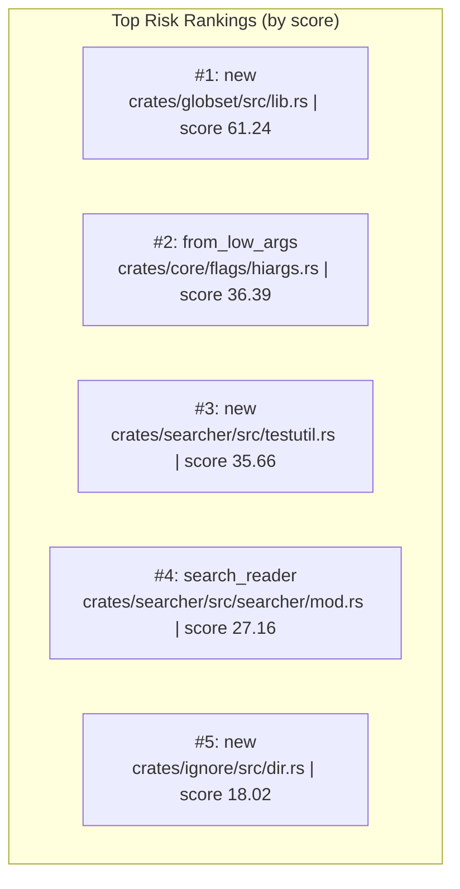
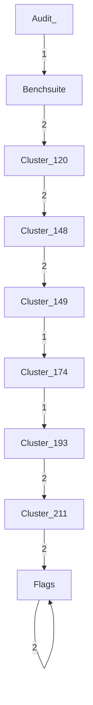

# Audit Report — rgp_onto (2026-11-21)

Generated: 2026-11-21T14:01:28.221Z | Commit: 14c3d03d34262e44cc5e666ce8854cfa0ac7566e

> **Partial report**
>
> - boundary-violations: Boundary violation analysis failed: Provide either rules or rules_file

## Risk Surface (top 10)
| Symbol | File | Risk Score | Callers | Churn |
|--------|------|------------|---------|-------|
| new | crates/globset/src/lib.rs | 61.24 | 18 | 1 |
| from_low_args | crates/core/flags/hiargs.rs | 36.39 | 4 | 1 |
| new | crates/searcher/src/testutil.rs | 35.66 | 48 | 1 |
| search_reader | crates/searcher/src/searcher/mod.rs | 27.16 | 7 | 2 |
| new | crates/ignore/src/dir.rs | 18.02 | 25 | 1 |
| add_child_path_with_found_ignore_files | crates/ignore/src/dir.rs | 13.31 | 2 | 1 |
| from_low_args | crates/core/flags/hiargs.rs | 11.96 | 4 | 1 |
| require | benchsuite/benchsuite | 11.71 | 25 | 1 |
| add_line | crates/ignore/src/gitignore.rs | 11.37 | 3 | 1 |
| configs | crates/searcher/src/testutil.rs | 11.23 | 1 | 1 |

### Top Risk Rankings

## Architectural Issues

### Import Cycles (4 detected)
- Cycle 1: extract → extract_alternation → extract_concat → extract_repetition
- Cycle 2: FAQ.md → GUIDE.md → README.md
- Cycle 3: stdout → stdout_buffered_block → stdout_buffered_line
- Cycle 4: from_ast_class_set → from_ast_class_set_item

### Coupling Outliers (instability > 0.8)
| Module | Ca | Ce | Instability |
|--------|----|----|-------------|
| Audit_ | 0 | 1 | 1.00 |
| Benchsuite | 0 | 2 | 1.00 |
| Cluster_120 | 0 | 2 | 1.00 |
| Cluster_148 | 0 | 2 | 1.00 |
| Cluster_149 | 0 | 1 | 1.00 |
| Cluster_174 | 0 | 1 | 1.00 |
| Cluster_193 | 0 | 2 | 1.00 |
| Cluster_211 | 0 | 2 | 1.00 |
| Flags | 0 | 2 | 1.00 |
| Flags | 0 | 3 | 1.00 |
| Flags | 0 | 3 | 1.00 |
| Flags | 0 | 3 | 1.00 |
| Hyperlink | 0 | 1 | 1.00 |
| Searcher | 0 | 3 | 1.00 |
| Tests | 0 | 2 | 1.00 |
| Tests | 0 | 3 | 1.00 |
| Tests | 0 | 2 | 1.00 |
| Searcher | 1 | 5 | 0.83 |

### Coupling Dependency Graph

### Boundary Violations (0)
Unavailable: boundary-violations did not complete (see warnings).

## Verification Gaps (0)
No uncovered files detected.

## Dead Code Candidates (20)
- bench_linux_literal_default (benchsuite/benchsuite)
- bench_linux_literal (benchsuite/benchsuite)
- bench_linux_literal_casei (benchsuite/benchsuite)
- bench_linux_re_literal_suffix (benchsuite/benchsuite)
- bench_linux_word (benchsuite/benchsuite)
- bench_linux_unicode_greek (benchsuite/benchsuite)
- bench_linux_unicode_greek_casei (benchsuite/benchsuite)
- bench_linux_unicode_word (benchsuite/benchsuite)
- bench_linux_no_literal (benchsuite/benchsuite)
- bench_linux_alternates (benchsuite/benchsuite)
- bench_linux_alternates_casei (benchsuite/benchsuite)
- bench_subtitles_en_literal (benchsuite/benchsuite)
- bench_subtitles_en_literal_casei (benchsuite/benchsuite)
- bench_subtitles_en_literal_word (benchsuite/benchsuite)
- bench_subtitles_en_alternate (benchsuite/benchsuite)
- bench_subtitles_en_alternate_casei (benchsuite/benchsuite)
- bench_subtitles_en_surrounding_words (benchsuite/benchsuite)
- bench_subtitles_en_no_literal (benchsuite/benchsuite)
- bench_subtitles_ru_literal (benchsuite/benchsuite)
- bench_subtitles_ru_literal_casei (benchsuite/benchsuite)

## Recent Drift
No recent structural drift.